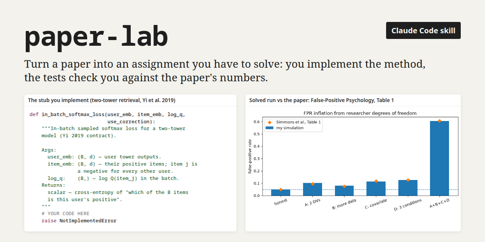
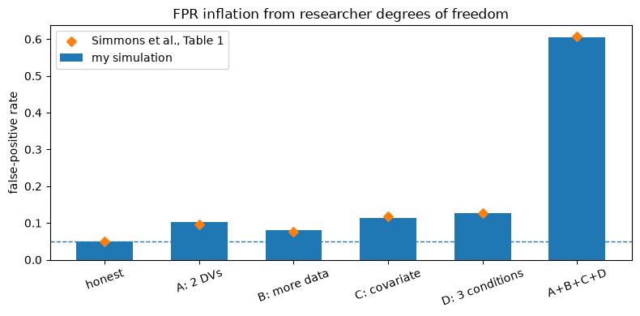
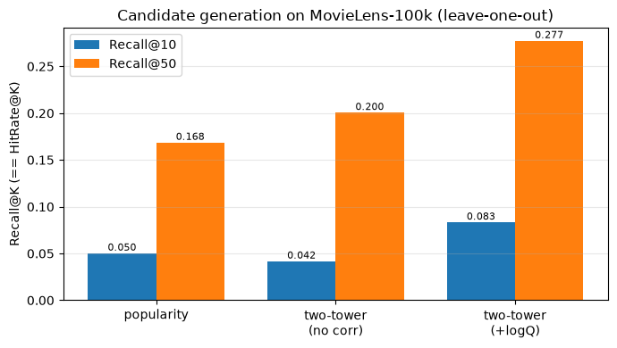

# paper-lab: turn a paper into an assignment you have to solve



A [Claude Code](https://claude.com/claude-code) skill that turns a paper (PDF, arXiv id,
lecture slides) into a Jupyter assignment in the style of Stanford CS231n or the Yandex
School of Data Analysis. You read the experiments first, implement the core of the
method yourself in stub functions, run it end to end on real data and check yourself
against numerical tests. The goal is to understand the paper, so the notebook gives you
the plumbing and leaves the method to you.

A stub and its test from [`examples/en/r_tower.ipynb`](examples/en/r_tower.ipynb), the
two-tower retrieval notebook. The docstring states the goal, not the operations:

```python
def in_batch_softmax_loss(user_emb, item_emb, log_q, use_correction):
    """In-batch sampled softmax loss for a two-tower model (Yi 2019 contract).

    Args:
      user_emb: (B, d) — user tower outputs for the B users in the batch.
      item_emb: (B, d) — item tower outputs for their B positive items.
                Item j is the positive of user j and an in-batch negative for every other user.
      log_q:    (B,) — log Q(item_j): log-probability that item j landed in the batch.
      use_correction: bool — whether to apply logQ correction.
    Returns:
      scalar tensor — batch-mean cross-entropy of the classification
      "which of the B items in the batch is this user's positive" ...
    """
    # YOUR CODE HERE
    raise NotImplementedError
```

```python
# with a uniform log_q the correction is a constant shift of each row of logits,
# softmax is invariant, so the two losses must match
lq_const = torch.full((B,), 1.234)
La = in_batch_softmax_loss(ue2, ie2, lq_const, use_correction=True)
Lb = in_batch_softmax_loss(ue2, ie2, lq_const, use_correction=False)
assert torch.allclose(La, Lb, atol=1e-5), \
    "with a uniform log_q the correction is a constant row shift and must not change the softmax/loss"
```

## What a notebook looks like

Every notebook follows the same shape:

1. **Experiments first.** Before the method, three slots to fill by hand: what the results
   actually show compared with the abstract, the weakest experiment, what was not tested.
2. **Theory, Feynman style.** Problem → mechanism → maths, plus an Inline Question on
   where your understanding has a hole.
3. **Parts that build on each other.** Each Part is a stub function with a docstring that
   states the goal, not the operations, followed by a test with `Expected ≈ …` and an
   assert message that names the likely mistake.
4. **The metric of the task.** The last Part reaches the metric the paper is measured
   with (nDCG, perplexity, return, false-positive rate), not a proxy like train loss.
5. **A controlled contrast.** The notebook reproduces the paper's *effect*: with-X vs
   without-X on the same data.
6. **Reflection and spoilers.** Where you would reach for this method next; full
   solutions at the bottom, opt-in.

The rules that make this happen are in [`SKILL.md`](SKILL.md). The central one is the
**completeness contract**: the paper's contribution must be a stub the student
implements, the run must reach the metric on the task, and the application of the method
must actually run.

## Examples

English, each with a solved and executed copy in [`examples/en/solved/`](examples/en/solved):

| notebook | paper | what you build | result of the solved run |
|---|---|---|---|
| [`r_tower`](examples/en/r_tower.ipynb) | Covington et al. 2016; Yi et al. 2019, *Sampling-Bias-Corrected Neural Modeling* | a two-tower retriever on MovieLens-100k with in-batch negatives and logQ correction | Recall@10 0.042 → 0.083 with logQ correction; the gain sits on popular items, as the paper predicts |
| [`rl_dqn`](examples/en/rl_dqn.ipynb) | van Hasselt, Guez, Silver 2016, *Deep RL with Double Q-learning* | DQN on CartPole-v1, then the Double DQN target, the training loop, and an overestimation check | value estimates 25.8 lower than vanilla DQN, return 111.5 ± 12.6 vs 64.1 ± 43.8 (3 seeds). The relative reduction holds on three seed sets; on a 30k-step CPU budget vanilla does not reliably overestimate in absolute terms, so only the relative effect is asserted |
| [`st_pval`](examples/en/st_pval.ipynb) | Simmons, Nelson, Simonsohn 2011, *False-Positive Psychology* | permutation test, t-test, a Monte Carlo of four researcher degrees of freedom | false-positive rate 60.4% with all four combined (paper: 60.7%), against 5% for the honest analysis |

The solved runs reproduce the effect each paper is about:

<table><tr>
<td width="50%"></td>
<td width="50%"></td>
</tr></table>

Russian, as generated (10 notebooks in [`examples/ru/`](examples/ru)): Adam, BatchNorm,
Dropout, ResNet, VAE, activation patching on IOI, DQN, Double DQN, two-tower retrieval
with logQ correction, False-Positive Psychology.

## Evaluation

How do you know a generated assignment is any good? The [`eval/`](eval) folder compares
paper-lab against real homework from the
[Yandex School of Data Analysis](https://github.com/yandexdataschool) courses: the
generator sees only the lecture, an LLM judge compares its notebook with the course
homework and labels every gap as a real deficit or a deliberate omission.

On 8 topics the mean score was **7.44 / 10**. Five deficits recurred across topics,
and each became a rule in the skill. The generated notebooks beat the reference in all 8
topics on numerical self-checks and on implementing the core from scratch. n = 8 and one
LLM judge is a signal, not a measurement; the [limitations](eval/README.md#limitations-honestly)
and the plan for a rerun on all 16 topics with negative controls are in the eval README.

## Install

```bash
git clone https://github.com/olyamasaeva/paper-lab ~/.claude/skills/paper-lab
```

Then ask Claude Code: "make a notebook for <paper>", "paper lab <pdf>", "reproduce
<arXiv url> as an assignment". Other agents that read `SKILL.md` work too.

Requirements: Python 3.10+, `pdftotext` (poppler-utils) for PDFs, optionally
[`defuddle`](https://github.com/kepano/defuddle) for web pages. The scripts are
stdlib only; each notebook lists its own dependencies (usually torch, numpy, matplotlib)
in its setup cell.

## Layout

```text
SKILL.md                       the skill: pipeline, notebook structure, completeness contract
scripts/extract_source.py      paper/lecture → page-aligned text chunks (no raw PDFs in context)
scripts/build_notebook.py      JSON spec → .ipynb with nbgrader metadata
reference/cell_spec_example.json
examples/en/, examples/ru/     generated assignments; examples/en/solved/ executed with outputs
eval/                          golden set, judge rubric, results
```

Notebooks carry nbgrader metadata, so they also work under `nbgrader autograde`.

## License

MIT, see [LICENSE](LICENSE). The eval manifest links to the public course repositories
and copies none of their content.
